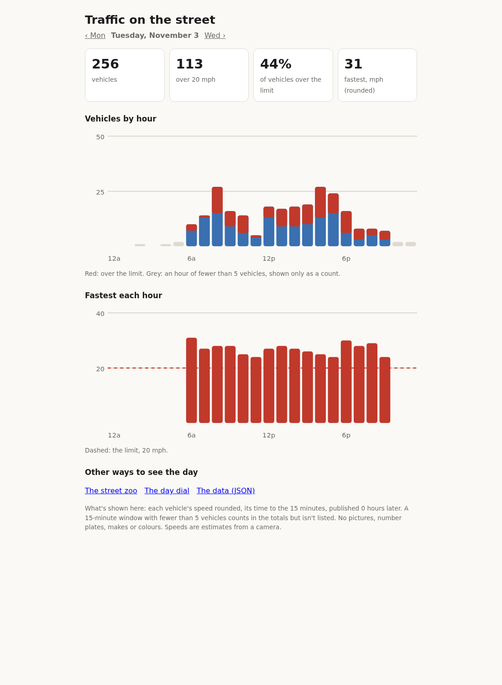

# safe-streets

Estimate the speed of passing vehicles from a fixed camera's recordings,
and publish what the street is like without publishing who was on it.



*The public page, on a made-up day of passes (`scripts/demo_day.py`). No
camera footage appears anywhere in this repository.*

## What it does

A camera looks side-on at a street. Every minute, `safe-streets` takes what
the camera recorded since the last batch, finds the stretches where
something moved on the road, and in each one:

- finds vehicles with a detector (RTMDet-tiny, on the CPU or an Intel GPU),
  or at night their headlights;
- follows each one along the lane you chose, frame by frame;
- turns the track into a speed through a calibration you make by driving
  past at a known speed, using each frame's own timestamp;
- stores the pass with its speed, a ± and any caveats, or without a speed
  when it can't say.

The **public page** shows each day's counts, the share over the limit and
rounded speeds by hour, plus two playful views (a street zoo, a day dial)
and the day as JSON. It never shows pictures, exact times or anything that
identifies a vehicle. The **operator's pages** (`/operator`, behind a
password) show each pass with its picture and clip, the calibration, logs
and health.

## What it needs

- **A recorder, not just a camera.** `safe-streets` never watches a live
  stream: it analyses recorded footage in batches, and needs clips whose
  frames carry their real timestamps. Use an NVR that keeps continuous
  recordings (UniFi Protect is supported directly; Frigate, Blue Iris or
  anything that writes segment files works through a folder), or the
  bundled ffmpeg recorder for a camera with only an RTSP stream
  ([examples/ffmpeg-segments.md](examples/ffmpeg-segments.md): check the
  stream's frame rate first).
- **A side-on view** of the lane you care about, firmly mounted
  ([docs/calibration.md](docs/calibration.md)).
- **A small Linux machine** with Docker. A few hundred cars a day fit on a
  few CPU cores; an Intel iGPU helps ([docs/hardware.md](docs/hardware.md)).
- **A car and a way to hold a known speed**, for two drives past the
  camera. That's the whole calibration.

## Quick start

```sh
git clone https://github.com/danhon/safe-streets && cd safe-streets
cp .env.example .env     # set SPEED_LIMIT, TZ and UNITS; FOOTAGE_DIR to your recordings
docker compose up -d --build
docker compose logs app | grep "set one at"
```

Open the setup link from the log to choose the operator's password, then
go to **Calibrate**: draw the road and your lane, drive past twice at a
known speed, and pick those two passes. Until then nothing gets a speed.
The public page is at `http://HOST:8080/`.

The build downloads the detector (RTMDet-tiny, about 20 MB, Apache-2.0)
from this repository's release, or uses your own `models/rtmdet-tiny/`
(`scripts/export_rtmdet.py`). Its checksum is checked either way.

## How accurate it is

Good enough to describe a street, not to fine anyone.

- On the reference install, two calibration drives at 15 mph read 15.7 and
  14.5 against the scale they set, and check drives at 20, about 15, and 19
  mph read 21.9, 15.8 and 19.3. Expect about ±2 mph in the lane and stretch
  of road the calibration drives covered, and worse outside it.
- Each speed comes with a ± from the spread of its track. Short tracks, a
  wide ±, low frame rates and passes outside the calibrated stretch are
  marked rough ("roughly" in public; the operator sees the ± and the
  flags). A track too short to say gets no speed but is still counted.
- It misses some vehicles, most often at dusk and at night, when it relies
  on headlights. Night speeds are less precise than daytime ones.
- The calibration is one scale along the road. That suits a side-on view
  and not a camera that looks along the street.

The reasons behind these choices, with their evidence, are in
[docs/decisions/](docs/decisions/README.md).

## Privacy by default

- Public pages show rounded speeds and times floored to 15 minutes, only for
  days at least 24 hours old, and don't list a 15-minute slot with fewer
  than 5 passes (it's counted, not listed). These are settings:
  `PUBLIC_TIME_BUCKET_MIN`, `PUBLIC_DELAY_HOURS`, `PUBLIC_MIN_GROUP`.
- No pictures, clips, exact times, pass ids, number plates, makes, models
  or colours reach a public page. Nothing reads number plates.
- Footage stays on your machine; the models run locally; nothing calls a
  cloud service. Clips are deleted after `CLIP_RETENTION_DAYS` (30).
- Mind the law where you live on recording a public street, and on
  publishing what you record.

## More

- [docs/architecture.md](docs/architecture.md): how a passing car becomes a speed
- [docs/calibration.md](docs/calibration.md): setting up and calibrating
- [docs/hardware.md](docs/hardware.md): what it costs to run
- [docs/worked-example.md](docs/worked-example.md): every value the reference install uses, and why
- [examples/](examples/): Traefik, Frigate, an RTSP recorder; `compose.gpu.yml` for an Intel GPU
- `HOOKS` (in `.env.example`): run your own code on each batch's new passes

MIT licensed. See [CONTRIBUTING.md](CONTRIBUTING.md).
