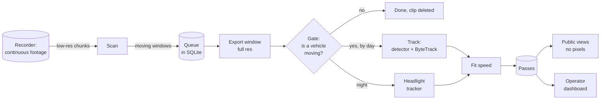

# Architecture

How a passing car becomes a speed. The costs are the reference install's
(one side-on camera over a residential street, a 4-core Linux box with an
Intel iGPU, 2026-11, running YOLO11n; see [worked-example.md](worked-example.md)).
Where `safe-streets` differs from it, this says so. The reasons behind each choice are in [decisions/](decisions/).

## The shape

One container: a Python app (FastAPI and Jinja, no JS framework) with an
in-process batch loop, SQLite, and its media on one volume. **It needs a recorder**, not a live stream: something that keeps continuous
footage and can hand over a time window with real per-frame timestamps. The
reference install uses UniFi Protect. A folder of segment files from
Frigate, Blue Iris or `ffmpeg -f segment` also works, and for an RTSP-only
camera with no NVR, the optional bundled recorder is that ffmpeg command.
Nothing analyses the live stream: batches run on what's been recorded.

## The stages

| Stage | What it does | Cost (reference install) | Code |
|---|---|---|---|
| **Scan** | Exports the next stretch of continuous recording on the low-res channel (640×360) and finds motion inside the road outline by background subtraction. Each moving window is queued as an event. | 5 min of footage: 14 MB, 1.4 s to export, 4–7 s of CPU | `scan.py`, `backfill.py` |
| **Export** | Exports each window at full resolution, padded by a few seconds. Every call has a timeout (decision 0012). | under a second, usually | `sources/` (`folder.py`, `protect.py`) |
| **Gate** | The detector at 2 fps on a wide crop of the road, only on samples where the road's brightness changed (the motion gate, 0007). Says whether a vehicle moved, and when. Parked cars, people and leaves stop here. | a few detector calls | `vision.py` (`Vision.motion_gate`) |
| **Track (day)** | The detector on every frame near each moving sample (episodes, 0007), linked by ByteTrack. Each sample keeps its frame's detection box (0006). Tracks are split where the box jumps; the run that moves furthest is kept; the leading edge is followed. | ~79 detector calls, ~14 CPU-s per car event on the CPU | `vision.py` |
| **Track (night)** | In infrared greyscale: saturated headlight blobs, linked frame to frame, judged for precision (0009); split tracks may be stitched across an occluder (0010). | ~87% cheaper than decoding again: it reuses the gate's frames | `lights.py` |
| **Fit** | Ground points through the calibration (a scale along the road, from known-speed drives) to metres along the road; a Theil–Sen line against each frame's pts (0001, 0003); the ± from its spread. Flags: short, uncertain, parked, partial, low fps, rough (0004). | negligible | `speed.py`, `geometry.py` |
| **Store** | A pass row per car, a shot (a crop of the car), the clip for a while. Overlapping windows are de-duplicated. | | `pipeline.py`, `db.py` |

The detector sits behind an interface (`detector.py`'s `Detector`: an image
in, boxes, scores and COCO classes out). The default is RTMDet-tiny
(mmdetection, Apache-2.0) as an OpenVINO IR, run on the CPU or an Intel GPU,
keeping boxes scored 0.25 or more (`YOLO_CONFIDENCE`). The reference install
ran YOLO11n, whose licence (AGPL) `safe-streets` can't carry. Replayed on
that install's footage, RTMDet-tiny at 0.25 missed fewer of the cars a
person confirmed than YOLO11n did, most of the gain at dusk, but each call
costs about 2.4 times the CPU (the reference install's Intel i5-6500, one
thread; 1.8 times on an ARM laptop). Read the costs above with that in mind. The tracker is
ByteTrack, vendored from its original MIT repository and ported to numpy.

## The batch loop

Every minute, `batcher.py`:

1. if `MAX_CPU_PRESSURE` is set, reads CPU pressure (0008) and waits
   while the box is busy (off by default);
2. scans the recording up to now and queues new windows;
3. analyses queued events: the last hour's oldest first, then any backlog
   newest first, up to 10 a batch, checking pressure before each;
4. gives the batch's new passes to the hooks named in `HOOKS` (the reference
   install posts, drives a wall display and draws reports from the same
   rows; `safe-streets` ships none).

The queue is in the database, so a restart or deploy loses nothing.
About once an hour it checks whether the camera has moved (0011).

## The data

SQLite, one file:

- **events**: one per moving window. Times, status (queued, processing,
  done, no vehicle, failed), the stages' timings.
- **passes**: one per car. Time at mid-road, class, direction, the speed
  (in m/s, shown in `UNITS`: mph or km/h), ±,
  metres and seconds covered, sample count, flags, the shot's path, and the
  calibration used. Old passes keep their calibration, so recalibrating
  doesn't rewrite history; stored clips can be re-analysed on request.
- **calibrations**: the road outline and lane, the scale from known-speed
  drives (stored as a homography; the reference install's is a plain scale
  along the road, set by two 15 mph drives, decision 0015), the reference
  frame, and a status: draft (the road is drawn, no scale yet: passes are
  tracked without speeds so a drive-by can be picked), active, or stale. A
  homography from measured ground points is possible but untested.

Clips are pruned after `CLIP_RETENTION_DAYS` (30); pass rows are kept.

## The web side

- **Public views** (`/`, `/day.json` and two playful views, `/zoo` and
  `/dial`) read only privacy-safe fields (0013): no pictures, no exact
  times, no pass ids, no makes or models. Times are floored to 15 minutes,
  a day is shown only once it's `PUBLIC_DELAY_HOURS` (24) old, and a time
  slot with fewer than `PUBLIC_MIN_GROUP` (5) passes is counted but not
  listed. They never depend on who is signed in, so they can be cached.
- **The operator's pages** (`/operator`, behind one password set through a
  one-time link the app logs at first start) show passes with shots and
  clips, the logs, the settings, calibration and health.
- **`/healthz`** always answers 200 while the process runs; its body says
  how long since a batch finished and whether that's stale. The operator's
  health page has the rest: the recorder, the detector's device, the
  calibration.
- **`/operator/calibrate`** is the calibration page ([calibration.md](calibration.md)):
  draw the road and lane, then pick a drive-by pass and enter its true
  speed.

## What the reference install adds

Not part of `safe-streets` v1: a Bluesky bot, a wall display, hourly report
cards, a vehicle-type classifier sidecar, rain records, and a music toy.
They hang off the same pass rows, which is why `safe-streets` gives them a
hook rather than a fork.
